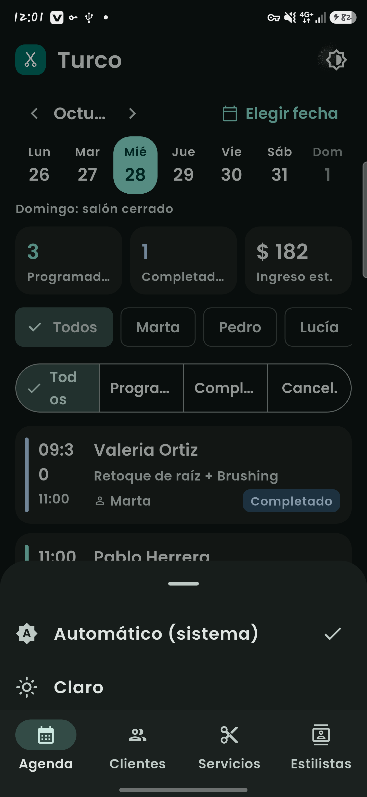
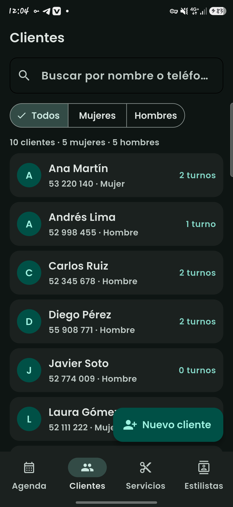
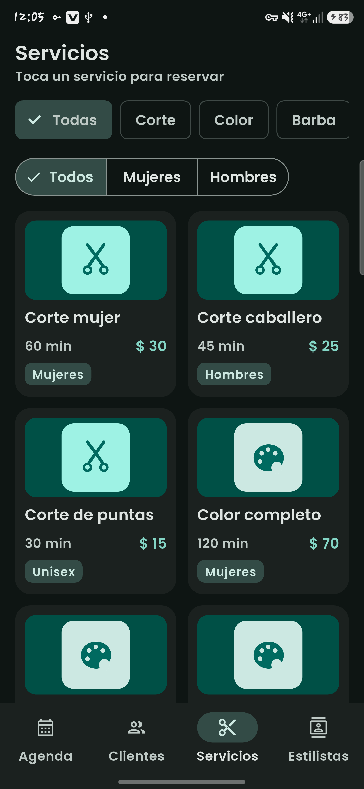
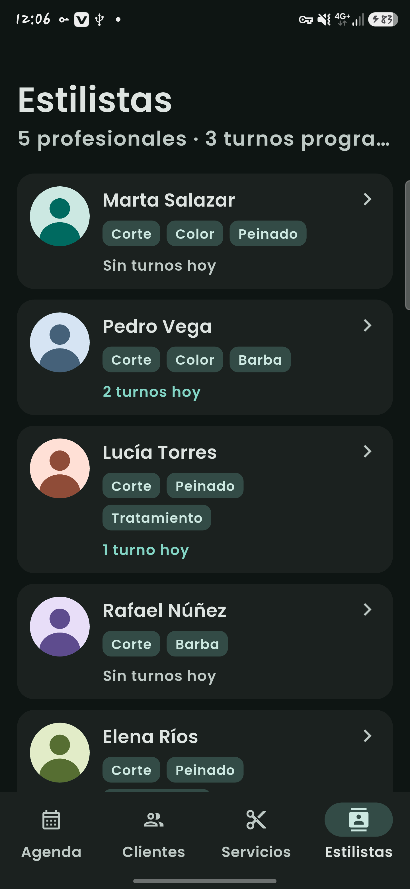
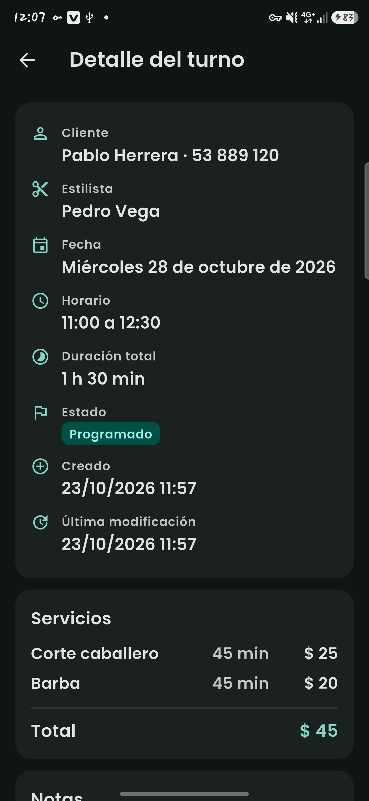
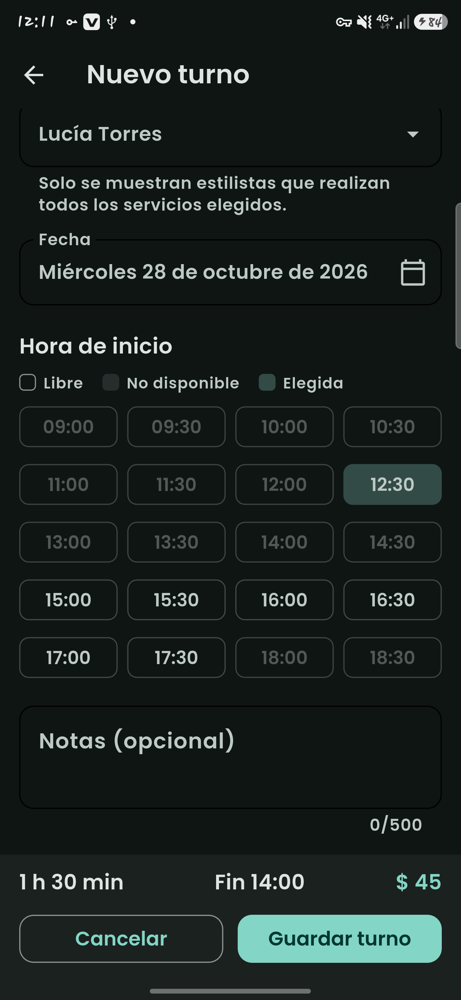
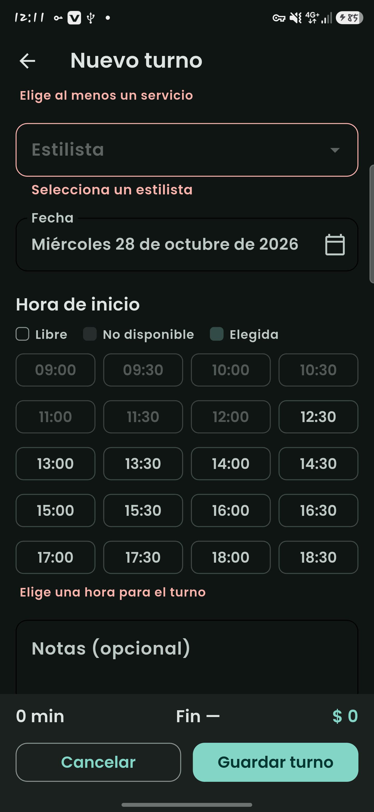
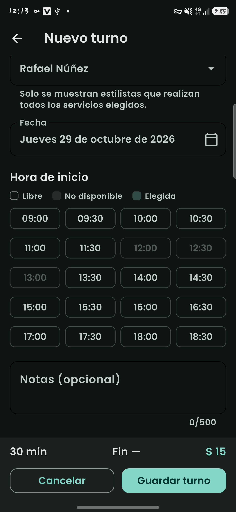
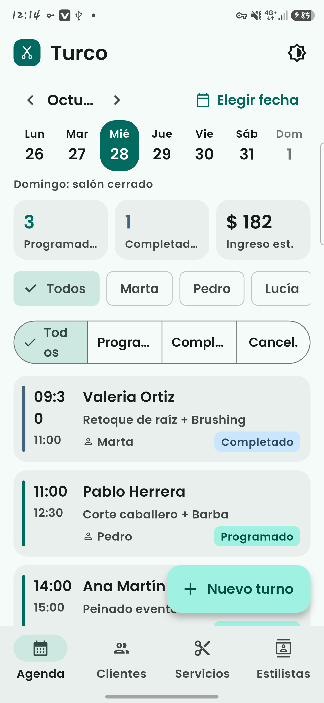
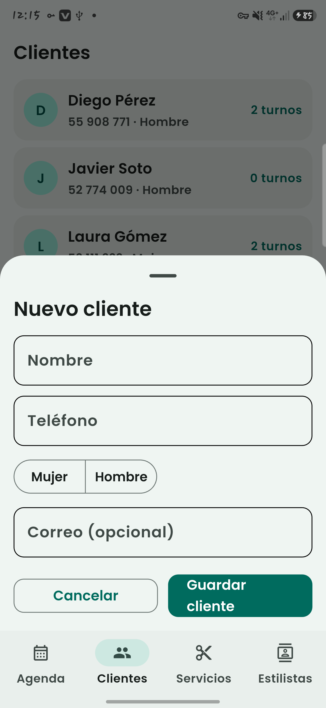

# Turco

Aplicación Flutter para Android que gestiona los **turnos de una peluquería mixta**: clientes, servicios, estilistas y agenda diaria. Proyecto del Primer Examen Parcial de *Programación para Dispositivos Móviles* (Ingeniería Informática, 3.er año).

- **Autor:** Marlom Sánchez
- **Application id:** `com.marlomsanchez.turco`
- **Nombre visible:** Turco
- **Versión de Flutter usada:** 3.47.8 (canal stable) · Dart 3.13.7
- **Plataforma:** Android
- **Datos:** todo en memoria, cargado desde datos de prueba. Sin servidor ni base de datos.

## Cómo inicializar y ejecutar

```bash
git clone https://github.com/marlomalejandrosp-sudo/turco
cd turco
flutter pub get
flutter run
```

Requisitos: Flutter SDK instalado, Android Studio con el SDK de Android y un emulador o un teléfono con depuración USB. Comprueba el entorno con `flutter doctor`.

## Cómo generar el APK release

```bash
flutter build apk --release
```

El archivo queda en `build/app/outputs/flutter-apk/app-release.apk`. El APK final se publica en la sección **Releases** del repositorio.

## Funcionalidades

- **Agenda:** turnos por día, tira de 7 días con cambio de semana, filtros por estilista y por estado, resumen del día, completar y cancelar turnos.
- **Clientes:** lista con búsqueda y filtro por género, alta, edición y eliminación desde una hoja inferior. Un cliente con turnos programados no se puede eliminar.
- **Servicios:** cuadrícula con filtros por categoría y público. Al tocar un servicio se abre el formulario de turno con ese servicio ya elegido.
- **Estilistas:** lista con barra superior plegable; al tocar uno se abre su agenda filtrada.
- **Detalle de turno:** datos completos y acciones (editar, completar, cancelar) solo si el turno está programado.
- **Formulario de turno:** cliente, servicios, estilista, fecha y hora, con validación, cuadrícula de horas con las no disponibles deshabilitadas, resumen fijo de duración, hora de fin y precio, y confirmación al salir con cambios sin guardar.
- **Tema claro y oscuro** con Material 3 y tipografía Poppins.

## Reglas de negocio

Están en los modelos y ViewModels, nunca en las pantallas.

- El salón abre de lunes a sábado, de 9:00 a 19:00, con franjas de 30 minutos.
- Un turno debe terminar a las 19:00 como máximo.
- No se pueden crear turnos en el pasado.
- Un estilista no puede tener dos turnos solapados, ni un cliente tampoco. Los intervalos son semiabiertos: un turno que empieza cuando otro termina no choca.
- Los turnos cancelados no ocupan horario.
- Solo se pueden editar, completar o cancelar los turnos programados.
- Solo se ofrecen estilistas que realizan **todos** los servicios elegidos.
- El teléfono del cliente tiene 8 dígitos y no se puede repetir.

## Arquitectura

MVVM con `ChangeNotifier` y `ListenableBuilder`, sin paquetes externos de estado.

- **Model:** entidades y reglas del salón (`models/`, `data/`).
- **ViewModel:** `SalonViewModel` (central, con las reglas) y un ViewModel por pantalla.
- **View:** pantallas y widgets reutilizables que solo muestran el estado y reenvían acciones.

Los ViewModels se crean una sola vez en `AppDependencies` y se pasan por constructor, de modo que las pestañas conservan su estado.

La navegación usa solo `go_router`:

| Ruta | Pantalla |
|---|---|
| `/agenda` (query `estilista`) | Agenda |
| `/clientes` | Clientes |
| `/servicios` | Servicios |
| `/estilistas` | Estilistas |
| `/turno/nuevo` (datos iniciales por `extra`) | Formulario de turno nuevo |
| `/turno/:id` | Detalle de turno |
| `/turno/:id/editar` | Formulario de edición |

Las cuatro primeras viven en un `StatefulShellRoute.indexedStack`. Detalle y formulario se abren sobre la barra inferior con `parentNavigatorKey`. Los diálogos y hojas inferiores se cierran con `Navigator.of(context).pop(valor)`, porque no son rutas de go_router.

## Estructura de carpetas

```
lib/
├── main.dart            # punto de entrada
├── app.dart             # MaterialApp.router y tema
├── app_dependencies.dart# creación única de los ViewModels
├── router/              # rutas de go_router
├── theme/               # tema claro y oscuro (Material 3)
├── core/                # formato, utilidades y navegación
├── models/              # Servicio, Estilista, Cliente, Turno y reglas
├── data/                # datos de prueba
├── viewmodels/          # estado y reglas de negocio
├── views/               # pantallas
└── widgets/             # componentes reutilizables
assets/
├── images/              # logo, categorías y avatares
└── fonts/               # Poppins
capturas/                # capturas reales de la app
```

## Capturas

| | |
|---|---|
|  |  |
|  |  |
|  |  |
|  |  |
|  |  |
